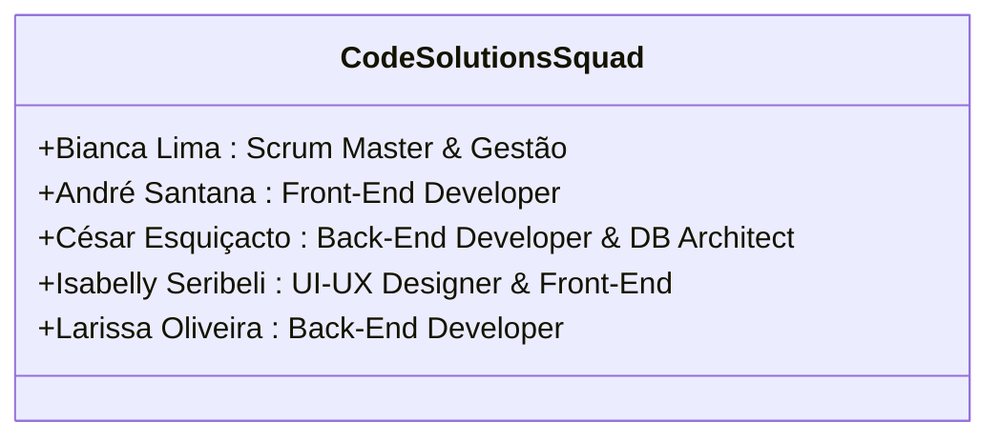
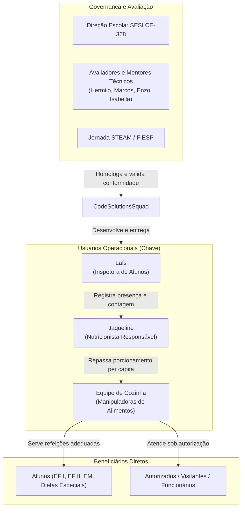

# Equipe de Projeto e Mapeamento de Stakeholders

---

## 1. Squad de Desenvolvimento: Code Solutions

A equipe multidisciplinar **Code Solutions** foi formada no contexto do Projeto Integrador com o compromisso de resolver desafios reais da comunidade escolar através da engenharia de software aplicada.

### Integrantes e Atribuições:

| Integrante | Papel no Projeto | Principais Responsabilidades |
| :--- | :--- | :--- |
| **Bianca de Freitas Lima Picolli** | **Scrum Master & Gestora de Projeto** | Facilitação de cerimônias ágeis (Sprint Planning, Daily Scrum, Sprint Review e Retrospectivas), remoção de impedimentos, interface formal com os diretores e coordenação da documentação formal do projeto. |
| **André Santana Soares** | **Desenvolvedor Front-End** | Desenvolvimento da interface web responsiva (mobile-first para a Inspetora e desktop para a Nutricionista), implementação dos componentes visuais, consumo de endpoints REST da API, ajustes de layout, CSS responsivo e interações via JavaScript/AJAX. |
| **César Augusto Esquiçacto Ferreira** | **Desenvolvedor Back-End & Arquiteto de Dados** | Modelagem relacional do banco de dados (MySQL/MariaDB), desenvolvimento da arquitetura RESTful em Laravel (V2), controle de autenticação (Sanctum/Tokens), migrações, endpoints de negócio e segurança de dados. |
| **Isabelly Seribeli dos Santos** | **UI/UX Designer & Desenvolvedora Front-End** | Criação do Manual de Identidade Visual (Brand Guidelines), design dos wireframes e protótipos de alta fidelidade no Figma, testes de usabilidade, paleta de cores e apoio à codificação das views no Front-End. |
| **Larissa Rayane de Oliveira Silva** | **Desenvolvedora Back-End** | Engenharia de software back-end, apoio na criação de migrações e rotas da API, regras de integridade do banco de dados, testes automatizados e validação de relatórios analíticos. |

---

## 2. Mapeamento de Stakeholders (Partes Interessadas)

A matriz de stakeholders identifica as partes que impactam ou são diretamente impactadas pelo sistema Menu Solutions:

### Detalhamento dos Papéis dos Stakeholders:

1. **Laís — Inspetora Escolar (Operadora Primária):**
   * *Necessidade:* Agilidade e simplicidade extrema no uso móvel. A inspetora não pode enfrentar telas complexas enquanto se desloca entre as salas no corredor.
   * *Interação no Sistema:* Login individualizado, seleção de sala/turma em poucos toques, botões grandes de incremento (+) e decremento (-), salvamento imediato e visualização do somatório matinal.
2. **Jaqueline — Nutricionista Técnica (Gestora Alimentar):**
   * *Necessidade:* Consolidação em tempo real do número total de alunos e desmembramento por categoria até as 07:30 da manhã; controle detalhado dos estudantes com laudos de restrição alimentar; cálculo de porcionamento per capita; controle de desperdício.
   * *Interação no Sistema:* Dashboard com atualização automática minuto a minuto, filtros por modalidade de ensino, visualização de cards de alunos com foto e patologias alimentares, módulo de autorização de avulsos, pesagem de sobras e geração de relatórios oficiais em PDF/Excel.
3. **Equipe de Cozinha e Manipuladoras de Alimentos:**
   * *Necessidade:* Previsibilidade do volume a preparar antes do aquecimento das panelas e início da cocção, evitando desespero operacional ou desperdício de bandejas inteiras.
   * *Interação no Sistema:* Recebimento dos números fechados validados pela nutricionista.
4. **Alunos da Escola SESI CE-368:**
   * *Necessidade:* Alimentação balanceada, segura (sem risco de anafilaxia ou contaminação para alérgicos) servida pontualmente nos horários de intervalo.
5. **Corpo Docente e Professores de Contraturno:**
   * *Necessidade:* Comunicação clara da presença de turmas especiais (Robótica, Personaliza, TRI, Tópicos Avançados) que permanecem na escola além do horário regular.
6. **Avaliadores Técnicos e Mentores (Hermilo, Marcos, Enzo, Isabella):**
   * *Necessidade:* Garantir rigor de engenharia de software, conformidade com a LGPD, segurança da informação, arquitetura de software limpa e eficiência computacional.
