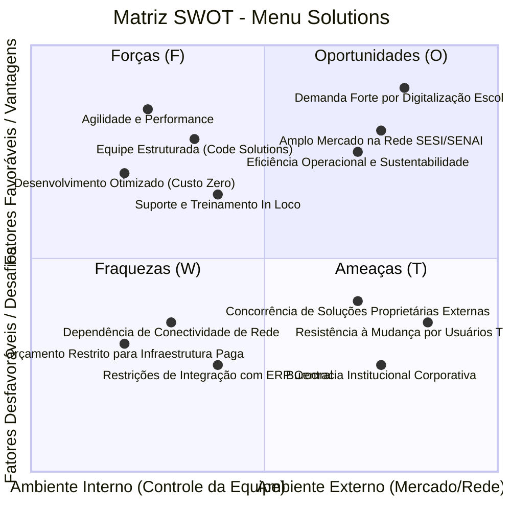
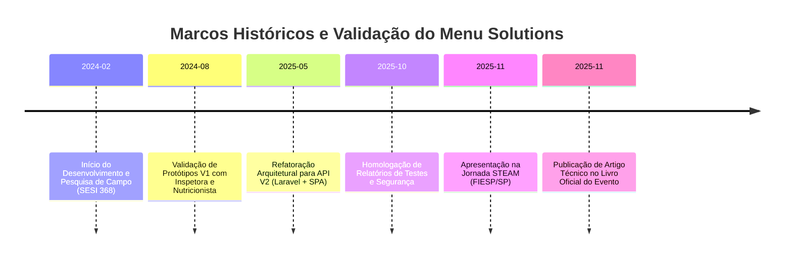

# Análise Estratégica SWOT e Métricas de Impacto

---

## 1. Matriz SWOT (FOFA) do Projeto

A análise SWOT foi formulada com base nas matrizes analíticas de campo (`matriz_swot4.xlsx`) e refinada ao longo das validações do projeto integrador:

### Detalhamento dos Quadrantes e Pesos:

| Quadrante | Fator Identificado | Grau de Importância | Peso Relativo | Impacto Estratégico |
| :--- | :--- | :--- | :--- | :--- |
| **Forças (Strengths)** | **Agilidade e Alta Performance** | Muito Importante (10.0) | 0.255 | Aplicação leve, rápida resposta em dispositivos móveis e consumo otimizado de memória. |
| | **Equipe Estruturada e Dedicada** | Importante (6.5) | — | Divisão clara de papéis de engenharia (Scrum, Front-End, Back-End, UI/UX). |
| | **Custo de Desenvolvimento Zero** | Pouco Importante (2.5) | — | Uso estrito de tecnologias de código aberto (PHP/Laravel, MySQL, JavaScript, Linux). |
| | **Suporte e Treinamento Presencial** | Importante (6.5) | — | Contato diário com os usuários finais na unidade CE-368. |
| **Oportunidades (Opportunities)** | **Demanda por Digitalização Escolar** | Muito Importante (10.0) | 0.230 | Transição mandatória da rede de ensino para eliminação de processos em papel. |
| | **Amplo Mercado Educacional (Rede SESI)** | Importante (6.5) | — | Potencial de replicação em mais de 50 Centros Educacionais do SESI-SP. |
| | **Eficiência Operacional & Sustentabilidade** | Importante (6.5) | — | Alinhamento direto com metas ESG e redução do desperdício de insumos públicos. |
| **Fraquezas (Weaknesses)** | **Dependência de Conectividade** | Importante (6.5) | 0.195 | Ausência de sinal Wi-Fi ou queda da rede local pode paralisar a sincronização em tempo real. |
| | **Restrições de Integração com Sistemas Centrais** | Importante (6.5) | — | Falta de APIs abertas autorizadas para conexão imediata ao ERP corporativo da FIESP. |
| | **Orçamento Restrito** | Importante (6.5) | — | Impossibilidade de contratar serviços em nuvem gerenciados caros durante a fase letiva. |
| **Ameaças (Threats)** | **Resistência à Mudança por Usuários Analógicos** | Importante (6.5) | 0.230 | Hábito histórico de preenchimento em prancheta de papel por funcionários antigos. |
| | **Burocracia Institucional** | Importante (6.5) | — | Prazos lentos para homologações e autorizações formais de segurança de TI da rede. |
| | **Concorrência de Soluções Globais de ERP** | Muito Importante (10.0) | — | Sistemas educacionais de grande porte que oferecem módulos genéricos de frequência. |

---

## 2. Métricas de Impacto Operacional e Sustentabilidade

A substituição do fluxo de contagem manual pela plataforma **Menu Solutions** gerou ganhos mensuráveis imediatos:

### 2.1. Economia de Tempo e Produtividade
* **Tempo diário economizado na contagem:** Redução de ~40 minutos para ~5 minutos (ganho de 35 minutos diários).
* **Tempo anual poupado:** Mais de **120 horas anuais** de trabalho da inspetoria liberadas para atividades pedagógicas e de acompanhamento dos alunos no pátio.
* **Pontualidade na entrega dos dados:** Cumprimento da meta crítica das **07:30** em 100% dos dias letivos após a implantação.

### 2.2. Sustentabilidade e Eliminação de Resíduos (ESG)
* **Economia direta de papel:** Mais de **200 folhas sulfite A4 anuais** eliminadas apenas na rotina de contagem da unidade CE-368.
* **Combate ao Desperdício Alimentar (ODS 2 e ODS 12 da ONU):**
  * *Fome Zero e Agricultura Sustentável (ODS 2)* e *Consumo e Produção Responsáveis (ODS 12)*.
  * O porcionamento exato baseado nos dados da contagem reduziu o índice de **sobra limpa** em alimentos perecíveis (arroz, feijão, hortaliças e carnes) e permitiu à nutricionista registrar o volume de restos nos pratos para ajustes nos cardápios futuros.

---

## 3. Validação Técnico-Científica e Visibilidade Externa

O projeto Menu Solutions alcançou notoriedade institucional através da participação e premiação em fóruns de excelência:

1. **Jornada STEAM (FIESP / São Paulo):**
   * Apresentação da solução e do modelo de arquitetura de software para banca de especialistas da Federação das Indústrias do Estado de São Paulo (FIESP).
   * Validação da relevância técnica, viabilidade econômica e aplicabilidade prática da ferramenta.
2. **Produção Científica e Publicação:**
   * Redação e aceite de artigo técnico-científico publicado no livro oficial da Jornada STEAM, registrando a metodologia de desenvolvimento, levantamento de requisitos e os resultados colhidos na Escola SESI CE-368.
3. **Plano de Expansão Regional:**
   * Estruturação da arquitetura modular para permitir que outras escolas da rede SESI-SP possam adotar a aplicação com esforço de configuração mínimo.
