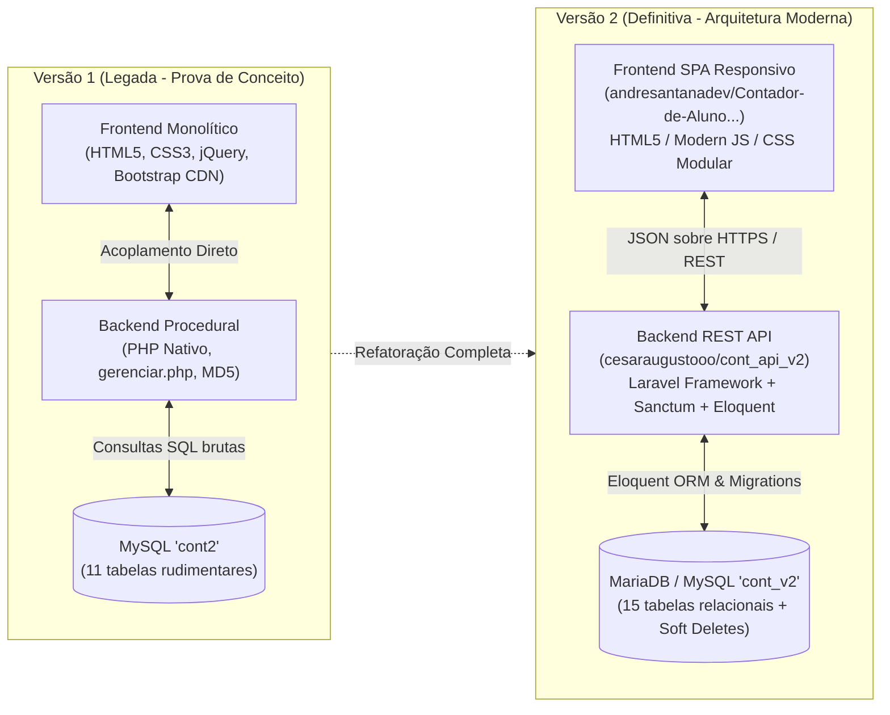
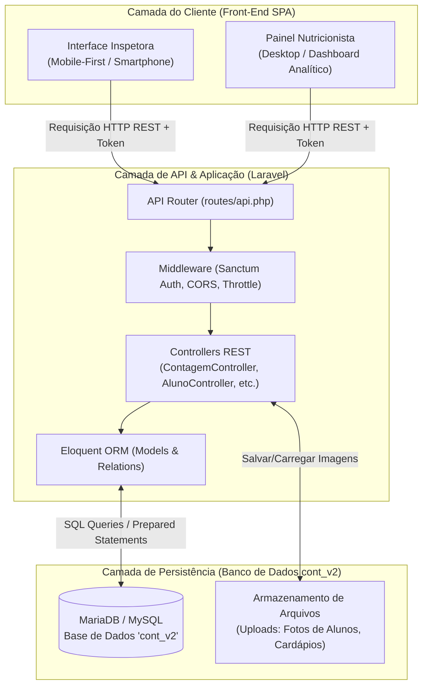

# Arquitetura Geral do Sistema: Comparativo Evolutivo (V1 vs V2)

Este documento detalha a evolução da arquitetura de software da plataforma **Menu Solutions**, analisando a transição da primeira versão (V1 — Prova de Conceito monolítica) para a versão definitiva (V2 — Arquitetura desacoplada baseada em API RESTful e SPA).

---

## 1. Visão Geral da Evolução Tecnológica

Durante o ciclo de vida do projeto integrador (2024-2025), a equipe **Code Solutions** percebeu que o crescimento das demandas da escola (inclusão de fotos de alunos, laudos de dietas especiais, autorização de avulsos e segurança LGPD) exigia uma estrutura mais robusta, segura e escalável do que o script procedural inicial.

---

## 2. Quadro Comparativo Detalhado (V1 vs V2)

| Critério Arquitetural | Versão 1 (V1) — Legada | Versão 2 (V2) — Produção Definitiva | Justificativa da Mudança |
| :--- | :--- | :--- | :--- |
| **Repositórios** | Repositório único: [`cesaraugustooo/Contador-V1`](https://github.com/cesaraugustooo/Contador-V1) | Repositórios desacoplados: • Back-End: [`cesaraugustooo/cont_api_v2`](https://github.com/cesaraugustooo/cont_api_v2.git) • Front-End: [`andresantanadev/Contador-de-Aluno-SESI-SENAI`](https://github.com/andresantanadev/Contador-de-Aluno-SESI-SENAI.git) | Separação de responsabilidades, permitindo que os desenvolvedores front-end e back-end trabalhem de forma independente sem conflitos de merge. |
| **Padrão Arquitetural** | Monolito com PHP procedural, arquivos de visualização misturados com regras de banco (`gerenciar.php`). | Arquitetura Orientada a Serviços (REST API) com padrão MVC no back-end e componentização no front-end. | Facilidade de testes, manutenção facilitada e possibilidade de plugar novos clientes (ex.: futuros totens de autoatendimento). |
| **Framework Back-End** | Nenhum (PHP nativo, scripts procedurais). | **Laravel (PHP 8.2+)** com Artisan, Eloquent ORM, Service Providers e Controllers REST. | Robustez de nível corporativo, padronização de rotas, injeção de dependências e ecossistema maduro. |
| **Banco de Dados** | `cont2` (MySQL/MariaDB, 11 tabelas). | `cont_v2` (MySQL/MariaDB, 15 tabelas estruturadas + tabelas de jobs e cache do framework). | Modelagem normalizada, criação de chaves estrangeiras com cascata, índices e suporte a soft deletes. |
| **Autenticação & Senhas** | Hash MD5 inseguro (`senha_user368`), sem proteção contra colisões; tabela manual de sessões (`sessions`). | **Laravel Sanctum** com geração de tokens Bearer criptografados; senhas armazenadas com **Bcrypt / Argon2** com salt dinâmico. | Atendimento a padrões de segurança cibernética e proteção de dados de alunos e servidores. |
| **Gestão de Sessão** | Tokens gravados manualmente na tabela `sessions` com campos de texto varchar. | Sessões nativas do Laravel gerenciadas com segurança via cookies HTTP-only criptografados ou tokens Sanctum na tabela `personal_access_tokens`. | Prevenção contra roubo de sessão (Session Hijacking) e persistência de login segura no mobile. |
| **Ciclo de Vida de Dados** | Exclusão física direta (`DELETE FROM`). Perda irreversível em caso de clique acidental. | **Soft Deletes** (`deleted_at`) em praticamente todas as entidades de negócio (`alunos`, `turmas`, `necessidades`, `contagens`, etc.). | Auditoria, histórico contábil e recuperação imediata em caso de falha humana. |
| **Camada de Estilo e UI** | Bootstrap via CDN remota (gerava lentidão em salas sem acesso à internet externa). | Estilos empacotados localmente no servidor da escola, eliminando bloqueios por falta de link externo de internet. | Garantia de operação contínua e renderização instantânea mesmo em modo intranet. |
| **Atualização em Tempo Real** | Polling assíncrono básico com jQuery `setInterval`. | Requisições otimizadas via Fetch/Axios com tratamento de erros, cache de requisição e polling programado para atualização do dashboard. | Menor carga sobre o servidor e experiência fluida para a nutricionista. |

---

## 3. Diagrama em Camadas da Solução Definitiva (V2)

---

## 4. Benefícios Conquistados com a Transição para a V2
1. **Resiliência a Falhas:** A perda de conexão temporária não quebra a aplicação; requisições possuem tratamento de status HTTP claro (401, 403, 404, 422, 500).
2. **Conformidade com a LGPD:** O isolamento das fotos e diagnósticos médicos dos estudantes em tabelas protegidas garante que apenas a nutricionista e os operadores autorizados tenham acesso visual aos dados sensíveis.
3. **Escalabilidade Multiturmas:** A V2 permite o cadastro ilimitado de turmas, categorias, disciplinas eletivas do Novo Ensino Médio e projetos de extensão sem impacto na performance do banco.
