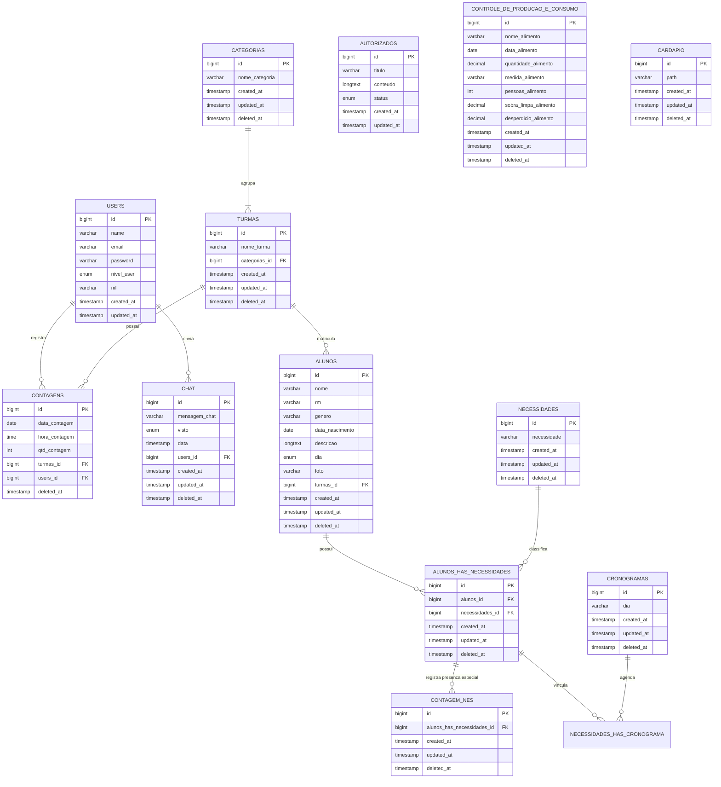

# Modelo de Dados e Dicionário da Base cont_v2

Este documento descreve a modelagem lógica e física do banco de dados relacional da versão definitiva do **Menu Solutions** (`cont_v2`), extraído diretamente do script de produção `cont_v2 (1).sql`.

---

## 1. Diagrama Entidade-Relacionamento (ERD)

---

## 2. Dicionário de Dados das Tabelas de Negócio

### 2.1. Tabela `users`
Armazena as contas de acesso dos operadores e administradores do sistema com níveis de privilégio (RBAC).

| Campo | Tipo | Nulo | Padrão | Descrição e Regras |
| :--- | :--- | :--- | :--- | :--- |
| `id` | bigint(20) UNSIGNED | Não | Auto Increment | Identificador único primário do usuário. |
| `name` | varchar(255) | Não | — | Nome completo do usuário (ex.: Laís, Jaqueline). |
| `email` | varchar(255) | Não | — | Endereço de e-mail institucional único para login. |
| `email_verified_at` | timestamp | Sim | NULL | Data de confirmação de e-mail (gerenciada pelo Laravel). |
| `password` | varchar(255) | Não | — | Hash Bcrypt seguro da senha de acesso. |
| `nivel_user` | enum('1','2','3') | Não | — | Nível de acesso: `1` = Inspetora; `2` = Nutricionista; `3` = Administrador. |
| `nif` | varchar(255) | Não | — | Número de Identificação do Funcionário (crachá SESI). |
| `remember_token` | varchar(100) | Sim | NULL | Token para funcionalidade "Lembrar-me". |
| `created_at` / `updated_at` | timestamp | Sim | NULL | Timestamps de auditoria de criação e alteração do registro. |

---

### 2.2. Tabela `categorias`
Classifica os segmentos educacionais e agrupamentos de salas da instituição.

| Campo | Tipo | Nulo | Padrão | Descrição e Regras |
| :--- | :--- | :--- | :--- | :--- |
| `id` | bigint(20) UNSIGNED | Não | Auto Increment | Identificador único da categoria. |
| `nome_categoria` | varchar(250) | Não | — | Nome oficial da categoria (ex.: Fundamental 1, Fundamental 2, Ensino Médio, Outros). |
| `created_at` / `updated_at` | timestamp | Sim | NULL | Timestamps de auditoria. |
| `deleted_at` | timestamp | Sim | NULL | Campo de Soft Delete para desativação lógica sem perda histórica. |

---

### 2.3. Tabela `turmas`
Identifica as classes físicas e agrupamentos de contraturno atendidos pela escola.

| Campo | Tipo | Nulo | Padrão | Descrição e Regras |
| :--- | :--- | :--- | :--- | :--- |
| `id` | bigint(20) UNSIGNED | Não | Auto Increment | Identificador único da turma/sala. |
| `nome_turma` | varchar(45) | Não | — | Nome da turma (ex.: 1° Ano E.F, 9° Ano E.F, Robótica, Personaliza). |
| `categorias_id` | bigint(20) UNSIGNED | Não | — | Chave estrangeira referenciando `categorias.id`. |
| `created_at` / `updated_at` | timestamp | Sim | NULL | Timestamps de auditoria. |
| `deleted_at` | timestamp | Sim | NULL | Timestamp de exclusão lógica (Soft Delete). |

---

### 2.4. Tabela `alunos`
Cadastro dos estudantes matriculados, permitindo identificação visual e escolar.

| Campo | Tipo | Nulo | Padrão | Descrição e Regras |
| :--- | :--- | :--- | :--- | :--- |
| `id` | bigint(20) UNSIGNED | Não | Auto Increment | Identificador único do aluno. |
| `nome` | varchar(45) | Não | — | Nome completo do estudante. |
| `genero` | varchar(200) | Não | — | Gênero declarado do estudante. |
| `descricao` | longtext | Sim | NULL | Observações pedagógicas ou clínicas relevantes. |
| `dia` | enum('Segunda','Terca','Quarta','Quinta','Sexta') | Sim | NULL | Dia habitual de permanência ou contraturno. |
| `foto` | varchar(255) | Sim | NULL | Nome do arquivo/path da fotografia de perfil do estudante no servidor. |
| `turmas_id` | bigint(20) UNSIGNED | Não | — | Chave estrangeira referenciando a turma em `turmas.id`. |
| `data_nascimento` | date | Não | — | Data de nascimento (para validação etária do per capita nutricional). |
| `rm` | varchar(200) | Não | — | Registro de Matrícula (código único do aluno no sistema escolar). |
| `created_at` / `updated_at` | timestamp | Sim | NULL | Timestamps de auditoria. |
| `deleted_at` | timestamp | Sim | NULL | Timestamp de Soft Delete. |

---

### 2.5. Tabela `necessidades`
Catálogo oficial das condições clínicas, alergias alimentares e dietas especiais da unidade.

| Campo | Tipo | Nulo | Padrão | Descrição e Regras |
| :--- | :--- | :--- | :--- | :--- |
| `id` | bigint(20) UNSIGNED | Não | Auto Increment | Identificador único da necessidade nutricional. |
| `necessidade` | varchar(250) | Não | — | Descrição da restrição (ex.: Doença Celíaca / Sem Glúten, Intolerância a Lactose, Alergia a Ovo, Diabético). |
| `created_at` / `updated_at` | timestamp | Sim | NULL | Timestamps de auditoria. |
| `deleted_at` | timestamp | Sim | NULL | Timestamp de Soft Delete. |

---

### 2.6. Tabela `alunos_has_necessidades`
Tabela associativa que vincula os estudantes às suas respectivas restrições alimentares com rastreabilidade temporal.

| Campo | Tipo | Nulo | Padrão | Descrição e Regras |
| :--- | :--- | :--- | :--- | :--- |
| `id` | bigint(20) UNSIGNED | Não | Auto Increment | Identificador único da associação. |
| `alunos_id` | bigint(20) UNSIGNED | Não | — | Chave estrangeira referenciando `alunos.id`. |
| `necessidades_id` | bigint(20) UNSIGNED | Não | — | Chave estrangeira referenciando `necessidades.id`. |
| `created_at` / `updated_at` | timestamp | Sim | NULL | Timestamps de auditoria. |
| `deleted_at` | timestamp | Sim | NULL | Timestamp de Soft Delete. |

---

### 2.7. Tabela `contagens`
Entidade central operacional que registra as aferições matinais de presença sala a sala.

| Campo | Tipo | Nulo | Padrão | Descrição e Regras |
| :--- | :--- | :--- | :--- | :--- |
| `id` | bigint(20) UNSIGNED | Não | Auto Increment | Identificador único da contagem. |
| `data_contagem` | date | Não | — | Data letiva da aferição (ex.: 2025-11-28). |
| `hora_contagem` | time | Não | — | Horário do registro (para controle de cumprimento do prazo das 07:30). |
| `qtd_contagem` | int(11) | Não | — | Quantidade de estudantes presentes na sala. |
| `turmas_id` | bigint(20) UNSIGNED | Não | — | Chave estrangeira referenciando `turmas.id`. |
| `users_id` | bigint(20) UNSIGNED | Não | — | Chave estrangeira referenciando o(a) inspetor(a) em `users.id`. |
| `deleted_at` | timestamp | Sim | NULL | Timestamp de Soft Delete. |

---

### 2.8. Tabela `contagem_nes`
Registro da presença diária individual dos alunos que possuem dietas e necessidades especiais.

| Campo | Tipo | Nulo | Padrão | Descrição e Regras |
| :--- | :--- | :--- | :--- | :--- |
| `id` | bigint(20) UNSIGNED | Não | Auto Increment | Identificador único do registro de presença em dieta especial. |
| `alunos_has_necessidades_id`| bigint(20) UNSIGNED | Não | — | Chave estrangeira referenciando `alunos_has_necessidades.id`. |
| `created_at` / `updated_at` | timestamp | Sim | NULL | Timestamps de auditoria (indica quando a presença da dieta foi confirmada). |
| `deleted_at` | timestamp | Sim | NULL | Timestamp de Soft Delete. |

---

### 2.9. Tabela `autorizados`
Gestão e controle de refeições avulsas para estagiários, servidores públicos e visitantes institucionais.

| Campo | Tipo | Nulo | Padrão | Descrição e Regras |
| :--- | :--- | :--- | :--- | :--- |
| `id` | bigint(20) UNSIGNED | Não | Auto Increment | Identificador único da autorização. |
| `titulo` | varchar(255) | Não | — | Nome da pessoa ou delegação autorizada (ex.: "Prefeito", "Estagiários"). |
| `conteudo` | longtext | Não | — | Detalhes, justificativa e orientações para o almoço. |
| `status` | enum('pendente','confirmado') | Não | — | Estado da solicitação: `pendente` (aguardando liberação) ou `confirmado` (aprovado pela Nutricionista). |
| `created_at` / `updated_at` | timestamp | Sim | NULL | Timestamps de auditoria. |

---

### 2.10. Tabela `controle_de_producao_e_consumo`
Métricas diárias de sustentabilidade, pesagem de alimentos e combate ao desperdício alimentar.

| Campo | Tipo | Nulo | Padrão | Descrição e Regras |
| :--- | :--- | :--- | :--- | :--- |
| `id` | bigint(20) UNSIGNED | Não | Auto Increment | Identificador do registro de pesagem. |
| `nome_alimento` | varchar(100) | Não | — | Descrição do alimento preparado (ex.: "Feijão carioca", "Arroz branco", "Frango grelhado"). |
| `data_alimento` | date | Não | — | Data da pesagem e do consumo. |
| `quantidade_alimento` | decimal(8,2) | Não | — | Quantidade bruta preparada (em quilogramas ou unidades). |
| `medida_alimento` | varchar(10) | Não | — | Unidade de medida (ex.: "kg", "g", "unid"). |
| `pessoas_alimento` | int(11) | Não | — | Total de pessoas que consumiram o item alimentar. |
| `sobra_limpa_alimento` | decimal(8,2) | Não | — | Quantidade de comida de boa qualidade não servida mantida na cozinha (em kg). |
| `desperdicio_alimento` | decimal(8,2) | Não | — | Resto-ingesta descartado das bandejas dos alunos no lixo orgânico (em kg). |
| `created_at` / `updated_at` | timestamp | Sim | NULL | Timestamps de auditoria. |
| `deleted_at` | timestamp | Sim | NULL | Timestamp de Soft Delete. |

---

### 2.11. Tabela `cardapio`
Gerenciamento das imagens e arquivos digitais do cardápio semanal.

| Campo | Tipo | Nulo | Padrão | Descrição e Regras |
| :--- | :--- | :--- | :--- | :--- |
| `id` | bigint(20) UNSIGNED | Não | Auto Increment | Identificador único do cardápio. |
| `path` | varchar(255) | Não | — | Caminho físico ou URI relativa da imagem do cardápio armazenada no storage da API. |
| `created_at` / `updated_at` | timestamp | Sim | NULL | Timestamps de publicação e alteração. |
| `deleted_at` | timestamp | Sim | NULL | Timestamp de Soft Delete. |

---

### 2.12. Tabela `chat`
Canal interno de mensagens rápidas entre Inspetoria e Nutrição.

| Campo | Tipo | Nulo | Padrão | Descrição e Regras |
| :--- | :--- | :--- | :--- | :--- |
| `id` | bigint(20) UNSIGNED | Não | Auto Increment | Identificador da mensagem. |
| `mensagem_chat` | varchar(100) | Não | — | Conteúdo textual da mensagem (sanitizado contra injeções de script). |
| `visto` | enum('s','n') | Não | — | Indicador de leitura: `'s'` = visualizada pelo destinatário; `'n'` = pendente de leitura. |
| `data` | timestamp | Não | — | Data e hora de envio da mensagem. |
| `users_id` | bigint(20) UNSIGNED | Não | — | Chave estrangeira referenciando o autor da mensagem em `users.id`. |
| `created_at` / `updated_at` | timestamp | Sim | NULL | Timestamps de auditoria. |
| `deleted_at` | timestamp | Sim | NULL | Timestamp de Soft Delete. |

---

### 2.13. Tabela `cronogramas` e `necessidades_has_cronograma`
Estruturação da escala semanal das turmas e alunos de contraturno.

* `cronogramas`:
  * `id`: bigint(20) UNSIGNED (PK)
  * `dia`: varchar(255) (Segunda, Terça, Quarta, Quinta, Sexta)
  * `created_at`, `updated_at`, `deleted_at`
* `necessidades_has_cronograma`:
  * `alunos_has_necessidades_id`: bigint(20) UNSIGNED (FK)
  * `cronograma_id`: bigint(20) UNSIGNED (FK)
  * `created_at`, `updated_at`, `deleted_at`
