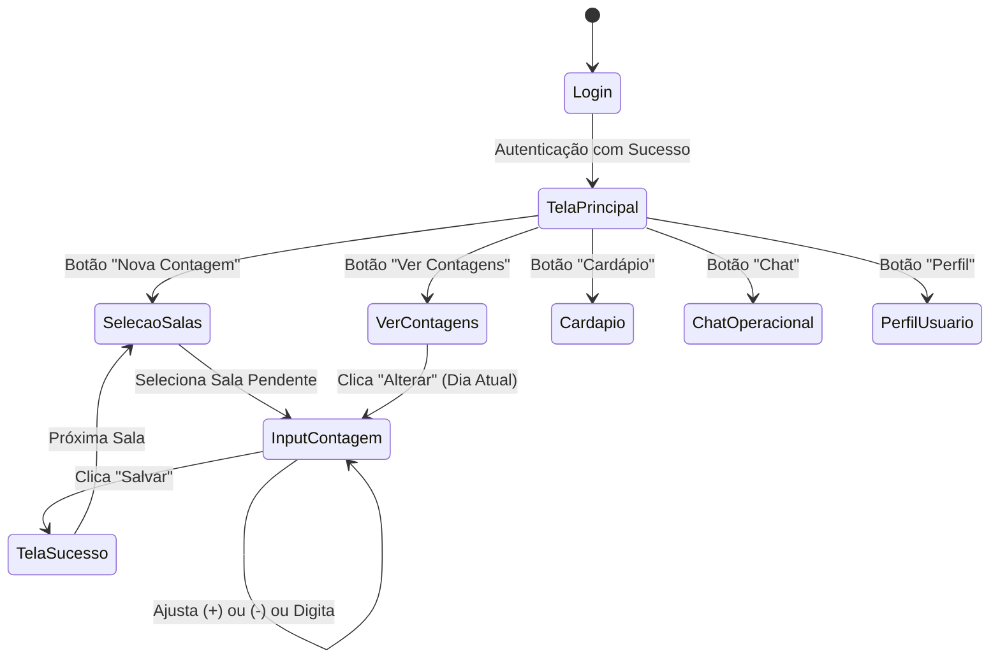
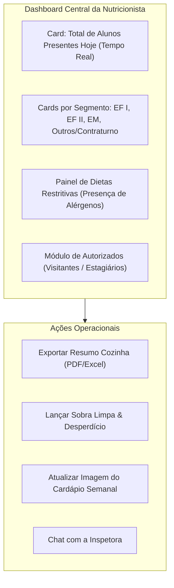

# Fluxos de Telas, UX e Evolução dos Protótipos

Este documento detalha a arquitetura de informação, as jornadas de usuário e a evolução das interfaces da plataforma **Menu Solutions**, mapeando os protótipos de baixa e alta fidelidade criados para a Inspetora e a Nutricionista.

---

## 1. Evolução da Experiência do Usuário (UX)

A concepção visual do sistema evoluiu de uma ferramenta rudimentar de digitação numérica para um **Painel de Controle Integrado e Analítico**:

```
[ PROTÓTIPO V1: RUDIMENTAR ]               [ PROTÓTIPO V2: PAINEL DE CONTROLE ]
- Campos de texto simples                  - Design System unificado (Cores da Marca)
- Busca complexa e estática                 - Cards responsivos com ícones e status
- Sem feedback em tempo real               - Atualização automática em tempo real (AJAX)
- Sem diferenciação visual de dietas        - Destaque com foto/RM para dietas especiais
- Quebra de layout em telas Full HD        - Responsividade total (Mobile-First a 1080p)
```

---

## 2. Jornada do Usuário: Inspetora (Mobile-First)

A interface da Inspetora (Laís) foi construída prioritariamente para smartphones, onde a facilidade de uso em deslocamento é prioritária:



### Principais Telas da Inspetora:
1. **Tela de Autenticação (Login):**
   * Formulário limpo com campos de Usuário/E-mail, Senha com alternador de visualização, link de suporte (`codesolutionsteam@gmail.com`) e termos de uso.
2. **Tela Principal (Dashboard Operacional Mobile):**
   * Saudação personalizada (*"Bom dia, Laís!"*), indicador de data atual, card de atalho rápido para **"Nova Contagem"**, **"Ver Contagens do Dia"**, **"Cardápio"**, **"Chat"** e **"Perfil"**.
3. **Tela de Seleção de Salas:**
   * Grid de botões com as turmas ativas:
     * Fundamental I: 1° ao 5° Ano EF I;
     * Fundamental II: 6° ao 9° Ano EF II;
     * Ensino Médio: 1°, 2° e 3° Ano EM;
     * Turmas Especiais: Funcionários, Robótica, Personaliza, TRI, Tópicos Avançados, Para Gabaritar.
   * Salas já contadas recebem badge de confirmação, impedindo duplicidade acidental.
4. **Tela de Registro de Contagem:**
   * Título destacado da turma, mostrador central de grande formato com a quantidade de presentes, botões ergonômicos de incremento `(+)` e decremento `(-)`, botão de confirmação verde e botão voltar.
5. **Tela de Confirmação:**
   * Modal visual: *"Contagem realizada com sucesso!"*, redirecionando imediatamente para a seleção da próxima turma.

---

## 3. Jornada do Usuário: Nutricionista (Desktop Analítico)

A interface da Nutricionista (Jaqueline) opera como a torre de controle da alimentação escolar, focada em visão macro, alertas médicos e previsibilidade:



### Principais Telas da Nutricionista:
1. **Dashboard em Tempo Real:**
   * Exibe o totalizador consolidado atualizado via AJAX a cada 60 segundos.
   * Gráficos em barra e pizza ilustrando a proporção de alunos por faixa etária (essencial para o cálculo do per capita nutricional).
   * Segregação estrita das turmas de contraturno ("Outros") para não distorcer o almoço regular da manhã.
2. **Tela de Alunos com Necessidades e Dietas Especiais:**
   * Tabela visual contendo:
     * Fotografia do aluno;
     * Nome civil e RM;
     * Turma matriculada;
     * Diagnóstico/Restrição (ex.: *Alergia a proteína do leite de vaca, Celíaco, Diabético tipo 1*);
     * Checkbox/Status de presença confirmado no dia.
3. **Tela de Controle de Produção e Desperdício:**
   * Formulário de pesagem com campos padronizados: Alimento, Quantidade Cozida, Medida (kg), Pessoas Servidas, Sobra Limpa (kg) e Desperdício de Bandeja (kg).
4. **Módulo de Autorizados Avulsos:**
   * Lista de solicitações de refeição com botão de aprovação rápida (`Pendente` $\to$ `Confirmado`).
5. **Central de Relatórios:**
   * Filtros por intervalo de datas (diário, semanal, mensal) e modalidade, com geração instantânea de arquivos PDF formatados para impressão e envio à sede regional do SESI.
